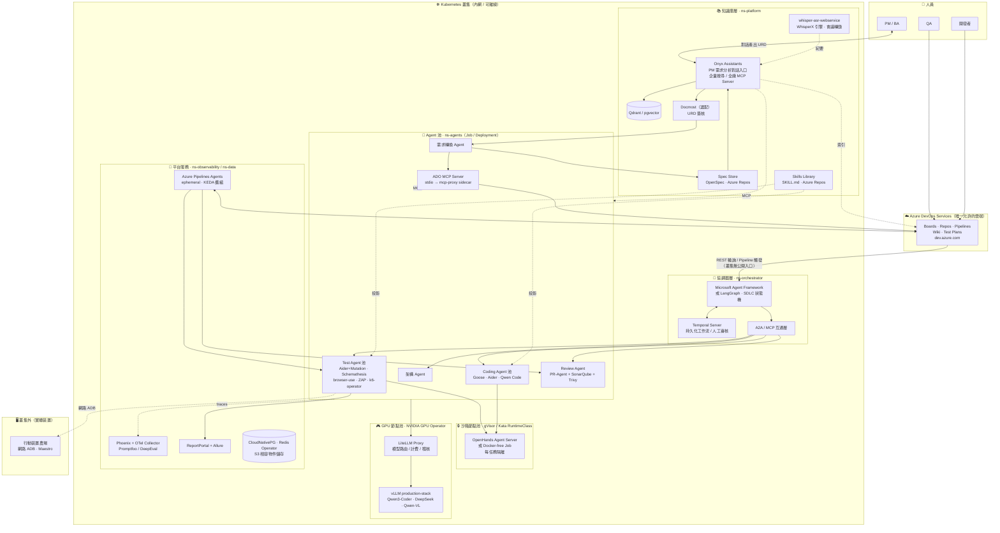

# AI Software Factory — 架構規劃與工具評估

> 研究日期：2026-11-07。五份詳細研究報告（含 URL、星數、授權、驗證過程）存放於 `research/`：
> [research-orchestrator.md](research/research-orchestrator.md)、[research-knowledge-base.md](research/research-knowledge-base.md)、[research-coding-agents.md](research/research-coding-agents.md)、[research-test-agents.md](research/research-test-agents.md)、[research-k8s-readiness.md](research/research-k8s-readiness.md)

## 1. 問題陳述與前提

建立一個多部門的 AI Software Factory：一個**協調器 (Orchestrator)** 在 SDLC 各階段（需求/URD → 設計 → 開發 → 測試 → 發布）派工給專責 Agent，並以**知識庫**作為全流程的共同記憶。

已確認的前提：

| 前提 | 決定 | 影響 |
|---|---|---|
| Coding Agent 生態 | **框架中立**，Copilot 只是其中之一 | 需以 MCP / Agent Skills / AGENTS.md 等開放標準作為整合層 |
| 部署 | **地端 Kubernetes 叢集為主**，**唯一允許的雲端服務為 Azure DevOps Services**；不使用任何其他雲端協調器 / 雲端 Agent / 雲端 LLM | 所有協調器、Agent、知識庫、測試工具必須可在內網 K8s 自建；叢集出網僅白名單 `dev.azure.com` / `*.visualstudio.com`；LLM 以 GPU 節點池上的 vLLM 為主（Azure OpenAI Private Endpoint 僅在資安核可後作為選配） |
| 原始碼與 CI/CD | **Azure DevOps** | 所有工具須驗證對 Azure Repos PR / Boards / Pipelines 的支援 |
| 文件深度 | 架構 + 工具比較 + 建議組合 + 導入階段 | 本文件 |

### 研究中發現的關鍵限制（會直接影響選型）

1. **GitHub Copilot coding agent 不支援 Azure DevOps**，且其沙箱由 GitHub 雲端託管 — 依「不使用雲端協調器」原則，**完全排除於自動化流程之外**（僅可能作為開發者個人 IDE 助手，不在本架構範圍）。
2. **Azure DevOps Wiki + Boards 沒有「結構化、Agent 可消費」的需求格式** — 沒有 Requirement 工作項、沒有追溯矩陣，Wiki 與 Work Item 之間無結構化連結。這是協調器必須補上的最大缺口。
3. 14 個 AI Code Review 工具中**僅 2 個可地端自建且有文件化的 Azure Repos PR 支援**：Qodo Merge/PR-Agent（OSS）、SonarQube（Developer+ 才有 PR 裝飾）。
4. 已過時/應排除：**AutoGen 已封存**（→ Microsoft Agent Framework）、**GPT-Pilot 有供應鏈惡意程式事件**、**Flowise 疑似封存**、**Qodo Cover 已封存**、**Daytona OSS 已停止維護**、Microsoft GraphRAG 維護模式、Devika 實驗階段。
5. **Claude Code 無法地端化** — 其模型只能呼叫 Anthropic / Bedrock / Vertex 雲端 API，無 Azure OpenAI 或本地模型路徑，因此**不列入 Agent 池**。

### 已排除的雲端方案（備查）

以下方案在研究中評估過，但因協調/執行發生在廠商雲端、或模型無法地端化，**一律排除**：

| 類別 | 排除項目 |
|---|---|
| 雲端協調器 / Agent 平台 | GitHub Copilot coding agent、Cognition Devin、Factory.ai Droids、Amazon Kiro、Google Jules / Antigravity、Azure AI Foundry Agent Service、Atlassian Rovo、Sourcegraph Amp |
| 雲端 Coding Agent / IDE | Cursor（CLI/Cloud Agent）、Windsurf、Gemini CLI、GitHub Copilot CLI、Claude Code（模型僅雲端）、OpenAI Codex CLI（模型僅雲端）、JetBrains Junie（產品層雲端） |
| 雲端測試 / Review | CodeRabbit、Sourcery、Ellipsis、Greptile、Graphite Diamond、Bito、Snyk、Postman AI、Testsigma / Mabl / testRigor / Functionize / Checksum / Octomind、Stagehand Model Gateway、Keploy AI 擴充（綁 Keploy Cloud） |
| 雲端知識庫 / 託管 | Confluence Cloud、Notion、Azure AI Search（Azure 託管）、Langfuse Cloud、LangSmith。Azure DevOps MCP **Remote** 模式（`mcp.dev.azure.com`，屬 ADO 服務範圍）→ 需資安確認後方可用，預設採 Local stdio |
| 沙箱 | E2B（雲端）、Daytona（OSS 停止維護） |

---

## 2. 建議架構



### 分層職責

| 層 | 職責 | 關鍵設計原則 |
|---|---|---|
| **知識庫層** | PM 撰寫 URD；轉換為結構化 Spec；提供 RAG 查詢；集中管理 Skills | Markdown + Git 為唯一真相來源；所有內容透過 MCP 對 Agent 曝露 |
| **協調器層** | SDLC 狀態機、派工、人工審核閘門、重試、稽核 | 協調邏輯與 Agent 實作解耦；用 A2A/MCP 呼叫 Agent，不綁定特定框架 |
| **Agent 池** | 各階段專責 Agent，可替換 | 同一份 Skills 投影到不同 Agent；Agent 產出必須是 Git diff / PR / 測試報告等可驗證產物 |
| **基礎設施** | LLM 閘道、沙箱、觀測 | 所有 LLM 呼叫經單一閘道（路由/成本/稽核）；模型全部跑在內網 GPU 節點池；每個任務在 gVisor/Kata 沙箱節點池執行 |
| **Azure DevOps Services** | 系統記錄 (System of Record)，**唯一雲端元件** | 叢集只做出站連線（HTTPS 白名單）；透過官方 MCP Server（stdio，以 sidecar 橋接）；叢集無公開入口 → 不用 Service Hooks，改 REST 輪詢或由 Pipeline（self-hosted agent）觸發 |

### Kubernetes 部署視圖

> 完整逐工具驗證見 [research-k8s-readiness.md](research/research-k8s-readiness.md)。

| 區塊 | 部署方式 | 備註 |
|---|---|---|
| **雲端（唯一）** | Azure DevOps Services | 叢集出站白名單 `dev.azure.com`、`*.dev.azure.com`、`*.visualstudio.com`、`*.vsassets.io`；叢集內無公開入口，雲端→叢集一律用出站輪詢或 Pipeline agent 拉取 |
| **叢集外** | 行動裝置農場 | Android 模擬器需 `/dev/kvm`，不進共享叢集 |
| **GPU 節點池** | NVIDIA GPU Operator；vLLM `production-stack` Helm（官方）；LiteLLM 官方 Helm | 離線環境需預先鏡像 driver container；Ollama 僅社群 chart，限開發機 |
| **沙箱節點池** | gVisor RuntimeClass（預設）/ Kata（需 VM 級隔離時）；OpenHands Agent Server（官方 Helm，無需 Docker socket） | Coding/Test Agent 以 Job 執行，不給 privileged |
| **ns-platform** | Onyx 官方 Helm（含 OpenSearch/SeaweedFS）；Qdrant 官方 Helm（標註非 production-ready，需自管備份）；Docmost **無官方 chart**（自寫 manifests） | |
| **ns-orchestrator** | Temporal 官方 Helm（僅 server 層，DB 自管）；MAF/LangGraph 自行容器化 | LangGraph **Platform** 自建需 Enterprise 授權且回連 LangChain → 只用 OSS library |
| **ns-agents** | Goose/Aider 官方映像作 Job；Qwen Code 自建映像（有 `qwen serve` daemon）；PR-Agent 以 Pipeline 步驟（Build Validation）執行，不開 webhook 入口；ADO MCP stdio + `mcp-proxy`/`supergateway` sidecar | |
| **測試/安全** | k6-operator（官方，避免 PrivateLoadZone）；trivy-operator（官方）；SonarQube 官方 Helm（關閉 privileged init，改節點層 sysctl）；ZAP/Nuclei/Schemathesis 作 Job；browser-use/Playwright MCP 容器內 `--no-sandbox` | **Keploy** OSS 需 root/eBPF，K8s 原生模式為商業+雲端 → 降為選配、隔離 VM |
| **ns-observability / data** | Phoenix Helm；ReportPortal 官方 Helm；CloudNativePG + Redis Operator + S3 相容儲存**集中共用** | Allure 僅社群 `allure-docker-service` |
| **CI Agent** | Azure Pipelines agent `--once` 容器 + KEDA `azure-pipelines` scaler | |
| **會議轉錄** | `whisper-asr-webservice`（`ASR_ENGINE=whisperx`）或 `Speaches`（OpenAI 相容 API） | Meetily 為桌面 app，不進 K8s |

**離線鏡像清單**：Helm OCI artifacts、GPU Operator driver containers、Trivy 弱點 DB、Nuclei templates、LLM/Whisper 模型權重、Onyx 嵌入模型。

### 核心資料流（一個 Feature 的生命週期）

1. PM 透過 **Onyx Assistant「需求分析師」** 對話產出 URD 草稿（可先用 whisper-asr-webservice 轉錄會議作輸入），存入 Wiki/Docmost
2. **需求轉換 Agent** 讀取 URD → 拆解為 OpenSpec 格式（SHALL + Given/When/Then）→ 提交至 Spec Store → 同步建立 Boards Epic/Feature/PBI 並回寫連結
3. 協調器偵測 Boards 狀態 → 啟動 Temporal 工作流 → **架構 Agent** 產出 ADR / API 契約（人工審核閘門）
4. 協調器依任務性質選擇 **Coding Agent**（複雜多步驟/工具使用 → Goose 或 Qwen Code；精準 diff 式實作/重構/測試撰寫 → Aider；兩者皆走本地模型）→ 在沙箱內執行 → `az repos pr create` 開 PR
5. Pipeline 觸發 **Review Agent**（PR-Agent + SonarQube + Trivy）與 **Test Agent**（單元測試生成 + 變異測試驗證、API 契約測試、E2E）
6. 測試結果以 Work Item ID 標記，回寫 Test Plans / Allure；ReportPortal 做失敗分析
7. 人工核准 → 合併 → 發布；全程 traces 進 Phoenix

---

## 3. 各環節工具評估

> 評分說明：✅ 推薦 / 🟡 可用但有條件 / ❌ 不建議（本情境）。星數為 2026-11-07 快照。

### 3.1 協調器 / 多 Agent 框架

| 工具 | 星數 / 授權 | 自建 | 模型中立 | 評價 |
|---|---|---|---|---|
| **Microsoft Agent Framework** | 14.6k / MIT | ✅ | ✅ MCP+A2A 原生 | ✅ **首選**。AutoGen+Semantic Kernel 繼任者，Python/.NET，企業級工作流，與 Azure 生態自然銜接但不鎖定 |
| **LangGraph** | 44.6k / MIT | ✅ | ✅ | ✅ 最成熟的狀態機引擎，最中立；需自行組裝治理層 |
| **CrewAI** | 60.6k / MIT | ✅ | ✅ | ✅ 角色式「部門」模型直覺；持久化執行較弱，適合搭配 LangGraph |
| **Temporal** | 成熟 / OSS | ✅ | N/A | ✅ **持久化骨幹**。多日等待人工審核、崩潰恢復、稽核 |
| OpenAI Agents SDK | 30.5k | ✅ | ✅ (100+ LLM) | 🟡 輕量可用，生態偏 OpenAI |
| Google ADK | 22.1k / Apache | ✅ | ✅ | 🟡 多語言 SDK 佳，範例偏 Gemini |
| Agno (AgentOS) | 43.1k / Apache | ✅ | ✅ | 🟡 頻繁轉型，API 穩定度疑慮 |
| n8n | 209k / Sustainable Use | ✅ | ✅ | 🟡 適合當通知/Webhook 膠水層，非推理引擎；授權需法務確認 |
| Dify | 160k / 修改版 Apache | ✅ | ✅ | 🟡 適合 PM 面向的 RAG/Chat 應用，非 SDLC 協調 |
| Mastra / PydanticAI | 29k / 21k | ✅ | ✅ | 🟡 TS 團隊選 Mastra；需強型別契約選 PydanticAI |
| AutoGen | — | — | — | ❌ **已封存** |
| Flowise | 55k | ? | — | ❌ 疑似封存，3 個月無活動 |

**參考專案（概念借鏡，非直接採用）**：MetaGPT（71k，PM→架構→工程→QA 的 SOP 角色模型）、ChatDev（35k，v1 為 SDLC 模擬，已轉型）、OpenHands/Agent Canvas（93k，MIT，**可自建作為 Coding 執行層**，支援多 Agent 後端）。

**已排除**：所有雲端協調器/平台（見第 1 節備查表）；GPT-Pilot ❌ 安全事件。

### 3.2 知識庫 / 需求分析 / Spec

**Wiki 平台**

| 工具 | 授權 / 星數 | Git-backed MD | MCP | 評價 |
|---|---|---|---|---|
| **Azure DevOps Wiki** | 內建 | ✅ 本身就是 Git repo | ✅ **官方** microsoft/azure-devops-mcp (2.1k) | ✅ **務實首選**。零新基礎設施、`#123` 原生連結 Work Item。缺點：規模大時層級難管理、搜尋弱、ACL 粗 |
| **Docmost** | AGPL + EE / 22k | ❌ (REST 匯出) | ✅ 宣稱原生 + 社群 | ✅ **PM 體驗升級選項**。地端企業定位、Draw.io+Excalidraw+Mermaid、**內建頁面審核簽核流程**（符合 URD 審核）。較年輕 |
| Wiki.js | AGPL / 29k | ✅ Git 同步模式 | 社群 | 🟡 Git 同步是亮點；單一維護者風險 |
| Outline | Source-available / 41k | ❌ | 社群 (121★) | 🟡 寫作體驗最佳；授權需法務審 |
| BookStack | MIT / 19k | ❌ | 社群最多 | 🟡 輕量、原生 draw.io；主開發已移至 Codeberg |
| XWiki | LGPL / 1.3k | ❌ | 弱 | 🟡 結構化 XObject 需求範本強；學習曲線陡 |
| MkDocs/Docusaurus | MIT | ✅ 純原始碼 | 不需要 | 🟡 docs-as-code，適合技術型 PM 走 PR 審核 |
| Confluence Data Center | 商業（地端版） | ❌ XHTML | **DC 無官方 MCP** | 🟡 UX 最佳但 Jira 中心、AI 整合缺口 |
| AFFiNE / AppFlowy | 混合 | ❌ | 社群 | ❌ 偏白板/筆記，不適合正式規格 |

> Azure DevOps Wiki 為 **Azure DevOps Services**（雲端，唯一允許）；Onyx 透過 ADO REST API 出站索引 Wiki 內容，索引副本留在內網。

**Spec-driven 工具（URD → Agent 可消費規格）**

| 工具 | 星數 / 授權 | 評價 |
|---|---|---|
| **OpenSpec** | 74k / MIT | ✅ **首選**。純 Markdown（SHALL + Given/When/Then）、brownfield 友善、**Stores 功能**：獨立 Spec Git Repo 供跨 repo 共用 |
| **GitHub Spec Kit** | 148k / MIT | ✅ 備選。constitution→spec→plan→tasks，Agent 中立，支援離線 |
| BMAD-Method | 55k / MIT | 🟡 完整方法論（PM/架構/UX/Dev/QA 人格），較重；v6→v7 遷移中 |
| awesome-copilot PRD skills | MIT | ✅ 直接可重用的 **prompt 層資產**（`prd.agent.md`、`breakdown-feature-prd`、issue 建立命令可改寫為 ADO Boards 版本） |
| Doorstop / StrictDoc | LGPL / Apache | 🟡 requirements-as-code、追溯矩陣；適合合規要求高的場景 |

**RAG / 企業搜尋 / PM 互動入口**

| 工具 | 授權 / 星數 | MCP | 評價 |
|---|---|---|---|
| **Onyx** (前 Danswer) | MIT core / 33k | ✅ **雙向官方**（本身是 MCP Server 也可消費 MCP） | ✅ **首選，同時作為 PM 的 AI 互動入口**。企業搜尋定位、Confluence DC 連接器、Ollama/vLLM 原生支援、Assistants（自訂人格/Prompt）、答案帶引用 |
| RAGFlow | Apache / 94k | 社群 | 🟡 解析引擎強（DeepDoc、知識圖譜），連接器與 MCP 弱 |
| LlamaIndex | MIT / 53k | 官方 (消費端) | ✅ 自訂管線的框架備選 |
| Dify | 修改版 Apache / 160k | 官方 (消費端) | 🟡 低程式碼工作流 App；若 Onyx Assistants 不足以表達多步驟訪談流程時補充 |
| AnythingLLM | MIT / 68k | 消費端 | 🟡 小團隊 chat-with-wiki |
| Open WebUI | 自訂授權 / 158k | 間接 | 🟡 當聊天前端，非連接器層 |
| LightRAG | MIT / 41k | 社群 | 🟡 輕量 Graph-RAG 引擎，需膠水 |
| Microsoft GraphRAG | MIT | — | ❌ 維護模式 |
| **向量庫** | | | **Qdrant**（Apache，效能/過濾強）或 **pgvector**（已有 Postgres 時最低維運） |

**PM 需求分析工作流（以 Onyx 為中心）**

```
會議錄音 ──whisper-asr-webservice (WhisperX)──▶ 轉錄稿 ─┐
                                           ▼
PM ◀──對話──▶ Onyx Assistant「需求分析師」 ──▶ URD 草稿 (Markdown)
               │  ├ Prompt：BMAD PM/Analyst 人格 + awesome-copilot PRD skill 結構
               │  ├ 知識：Onyx 索引的 Wiki / OpenSpec Store / 舊 URD / 設計文件
               │  └ 工具：ADO MCP（查 Boards 既有工單）、OpenSpec Store MCP
               ▼
       存入 Docmost（簽核）或 ADO Wiki ──▶ 需求轉換 Agent ──▶ OpenSpec + Boards
```

- **Onyx Assistants**：建立「需求分析師」「驗收條件撰寫」「衝突檢查」等角色，Prompt 來源為 BMAD-Method（MIT）PM/Analyst 人格與 awesome-copilot `skills/prd/` 範本；PM 不需學 CLI。
- **Onyx 連接器**：Web/檔案連接器索引 ADO Wiki（Onyx 無原生 ADO 連接器）；Confluence DC 連接器若有舊文件；Git 連接器索引 OpenSpec Store。
- **Onyx 作為 MCP Server**：下游 Coding/Test Agent 也用同一個知識入口查需求與設計脈絡，避免兩套知識庫。
- **會議 → 需求**：**whisper-asr-webservice**（MIT，K8s 服務，`ASR_ENGINE=whisperx` 含講者分離，CPU/GPU 映像）或 **Speaches**（OpenAI 相容 API）→ 轉錄稿貼入 Onyx Assistant 產紀要與 URD 草稿。Meetily 為桌面 app 不進 K8s；開源 PRD 產生器皆 <70★，**不採用為基礎設施**，僅作 prompt 參考。
- **待驗證**：Onyx Assistants 的工具呼叫（MCP action）成熟度、對 ADO Services Wiki 的索引方式（REST API + PAT/Entra 服務主體）、EE 功能邊界（RBAC/稽核）。

### 3.3 Coding Agent 與 Skill 生態

| Agent | 無頭/API | 模型中立 | 本地模型 (vLLM/Ollama) | 完全自建 | 授權 | 評價 |
|---|---|---|---|---|---|---|
| **Goose** (Block/Linux Foundation) | ✅ CLI+API | ✅ 15+ 供應商 | ✅ | ✅ | Apache-2.0 | ✅ **主力通用 Agent**。MCP 原生、可建自訂發行版、Linux Foundation 治理 |
| **Qwen Code** | ✅ CLI | ✅ | ✅ 原生 Ollama/vLLM | ✅ | OSS | ✅ **複雜多步驟任務**。SubAgents / Agent Teams / Auto-Skills，可搭配開源 Qwen 權重完全離線；較新 |
| **Aider** | ✅ `--message --yes` | ✅ LiteLLM | ✅ | ✅ | Apache-2.0 | ✅ **精準實作/重構/測試撰寫**。CI 腳本化最成熟穩定；agentic 迴圈較簡單 |
| **OpenHands / Agent Canvas** | ✅ REST API | ✅ | ✅ | ✅ | MIT | ✅ **Coding 執行層/沙箱控制台**。可驅動自家 Agent 或任何 ACP 相容 Agent |
| Cline (CLI/SDK) | ✅ 無頭 CLI | ✅ | ✅ | ✅ | OSS | 🟡 可用備選；SDK 適合自訂整合 |
| Continue.dev | ✅ CLI | ✅ | ✅ | ✅ | OSS | 🟡 需再驗證無頭模式 |
| Plandex | ✅ CLI+Server | ✅ | 可能 | ✅ 自建 Server | 需確認授權 | 🟡 大型多檔重構專家 |
| SWE-agent / mini-SWE-agent | ✅ YAML | ✅ | ✅ | ✅ | MIT | 🟡 研究級；適合作為**內部評測 harness** 基底 |
| Roo Code / Kilo Code | 有限 | ✅ | ✅ | IDE 內 | OSS | 🟡 IDE 中心，無頭能力弱 |
| Amazon Q CLI | — | — | — | — | 已封存 | ❌ |
| *Claude Code、Codex CLI、Copilot、Cursor、Gemini CLI、Devin、Amp、Windsurf、Junie* | — | — | ❌ 模型/控制平面在雲端 | ❌ | — | ❌ **已排除**（見第 1 節） |

> 注意：地端 Agent 的實際品質高度取決於本地模型能力（如 Qwen3-Coder、DeepSeek-Coder、GLM 等開源權重）與 GPU 資源。Phase 2 評測集的首要目的就是量化「本地模型 + 上述 Agent」在貴公司程式碼上的表現。

**可攜式 Skill 標準（一份 Skill Library 投影到多個 Agent）**

| 標準 | 用途 | 支援 |
|---|---|---|
| **Agent Skills** (agentskills.io, `SKILL.md`) | 漸進式揭露的程序性知識 | 開放標準，支援端持續增加（見 agentskills.io/clients）；Qwen Code 有 Auto-Skills |
| **AGENTS.md** | 最低共同分母的專案指令 | 幾乎所有 Agent 都會讀取 |
| **MCP** | 工具整合層（ADO、Wiki、RAG、DB） | Goose / Qwen Code / Aider(經 MCP 橋接) / OpenHands / Cline 皆支援 |
| Goose extensions / Cline rules 等 | 各家專屬 | 由 CI 從 Skill Library 自動產生 |

設計：`skills-library` Azure Repo（依 SDLC 階段分類：architecture/api-design/database/implementation/refactoring/testing/security/iac/docs）→ Azure Pipeline 在合併至 main 時渲染成 `AGENTS.md`（扁平化）、Goose extension、Qwen Code skills 目錄等各家格式。種子來源：anthropics/skills（Apache，格式參考）、github/awesome-copilot（MIT，PRD/規劃 skills 可移植）。

**沙箱與治理**：Docker/devcontainer 或 OpenHands Runtime（每任務隔離）+ gVisor；**LiteLLM Proxy** 作為所有 Agent 的唯一 LLM 出口（路由、成本、稽核），後端全部指向內網 vLLM/Ollama；密鑰只經內網 Vault / Pipeline 變數群組注入，**絕不**寫入 SKILL.md/AGENTS.md。

### 3.4 測試 Agent 與程式碼審查

**單元/整合測試生成**

| 工具 | 授權 | 評價 |
|---|---|---|
| **Aider** 包裝「生成→執行→覆蓋率閘門→修復」迴圈 | Apache | ✅ **首選**（純 LLM 測試產生器不是封存就是未釋出） |
| **變異測試閘門**：Stryker (JS/.NET)、PIT (Java)、mutmut (Python) | Apache/BSD | ✅ **必備** — 攔截 AI 產生的「只執行不斷言」假測試 |
| Diffblue Cover | 商業，可離線 | 🟡 Java 專用、零 LLM 依賴、**有 Azure Pipelines 官方指南** |
| Keploy | Apache / 20k | 🟡 流量錄製回放 → API 回歸測試 + Mock；**OSS 需 root/eBPF，K8s 原生模式為商業版且綁雲端** → 選配，跑在隔離 VM |
| Pynguin | MIT | 🟡 Python 傳統搜尋式，**必須沙箱**（可能清空磁碟） |
| Qodo Cover | AGPL | ❌ 已封存 |

**E2E / UI**

| 工具 | 授權 / 星數 | 本地 LLM | 評價 |
|---|---|---|---|
| **browser-use** | MIT / 120k | ✅ 自訂 OpenAI 相容 base URL（指向 vLLM/Ollama） | ✅ **Web 首選**；視覺理解需本地 VLM（如 Qwen-VL） |
| **Playwright MCP** | Apache / 39k | N/A（由 MCP client 決定） | ✅ 自癒式瀏覽器自動化層 |
| **Midscene.js** (ByteDance) | MIT / 15.5k | ✅ 任何 OpenAI 相容端點 | ✅ 自然語言 YAML，**Web + Android** |
| **Maestro** | Apache / 16k | N/A（確定性 YAML + MCP） | ✅ **行動裝置首選**，Meta/Expo 生產使用；**模擬器需 KVM → 跑在叢集外裝置農場（網路 ADB）** |
| Stagehand | MIT / 26k | 🟡 需寫 BYO-LLM callback | 🟡 |
| Skyvern / TestZeus Hercules | **AGPL** | ✅ | 🟡 法務核可 AGPL 後可用 |
| Shortest | MIT | ❌ 鎖 Anthropic | ❌ 且已停滯 |
| Magnitude | — | — | ❌ 專案已轉型 |
| Testsigma/Mabl/testRigor 等 | SaaS | ❌ | ❌ |

**API 測試**：**Schemathesis**（MIT，OpenAPI 屬性測試，Allure 輸出，官方映像可作 K8s Job）✅ 首選；RESTler（微軟，MIT，**自身 CI 跑在 ADO**）/ EvoMaster 做狀態式/安全模糊測試；Keploy 僅選配（見上表）；Bruno/Hoppscotch 為離線 API client（無 AI）。LLM 從 spec 生成 API 測試仍屬學術階段。

**AI Code Review（Azure Repos PR 支援已驗證）**

| 工具 | 授權 | 自建 | 本地 LLM | **ADO PR** | 評價 |
|---|---|---|---|---|---|
| **Qodo Merge / PR-Agent** | MIT | ✅ | ✅ LiteLLM | ✅ **有 azure-pipelines.yml 範例** | ✅ **首選**。注意：Azure Repos 不支援 YAML `pr:` 觸發，需用 Build Validation 政策 |
| **SonarQube** | Community OSS / Developer+ 商業 | ✅ | N/A | ✅ 但 **PR 裝飾需 Developer+** | ✅ SAST/品質閘門 |
| **Trivy** | Apache | ✅ | N/A | 通用 CLI 步驟 | ✅ 容器/IaC/密鑰掃描 |
| Semgrep CLI | OSS core | ✅ CLI | N/A | 🟡 PR 留言矩陣只列 GitHub/GitLab | 🟡 當通用 CI 步驟 |
| CodeQL | GHAS 授權 | — | — | 🟡 可經 **GitHub Advanced Security for Azure DevOps**（付費附加，屬 ADO Services 範圍） | 🟡 需確認授權與資安立場 |
| CodeRabbit / Sourcery / Bito / Ellipsis / Greptile / Graphite / GitLab Duo | SaaS | — | — | — | ❌ 雲端或不支援 ADO，**已排除** |

**效能/安全**：k6（AGPL，需法務注意）+ Locust（MIT）；OWASP ZAP Automation Framework（Apache，exit code 閘門）+ Nuclei（MIT）+ Trivy；PentestGPT / HexStrike（MIT，支援 Ollama）僅作**人工監督的週期性輔助**，非 CI 閘門。

**測試管理與追溯**：Azure Test Plans（原生 Work Item 圖譜，WIQL 可查）+ Allure Report（官方 ADO 擴充）+ **ReportPortal**（Apache，唯一可自建的 ML 失敗分群）；輕量替代：pytest-azurepipelines `record_pipelines_property()` 標記 Work Item ID + sphinx-needs 產生追溯矩陣。

**Agent 自身評測與觀測**：**Arize Phoenix**（100% OSS、可離線）為觀測後端 + OTel GenAI 語意慣例；**Promptfoo**（原生 ollama / OpenAI 相容 provider）+ **DeepEval**（agent 軌跡評測）為回歸閘門；仿 **SWE-bench** 架構建內部「真實工單 + 隱藏測試」評測集。Langfuse 自建版僅在需 RBAC/稽核日誌（EE 付費）時考慮；Langfuse Cloud 排除。

---

## 4. 建議組合（Recommended Stack）

| 層 | 首選 | 備選 / 補充 |
|---|---|---|
| **協調器** | Microsoft Agent Framework + Temporal（官方 Helm，DB 自管） | LangGraph OSS library + CrewAI（**不用** LangGraph Platform：需 Enterprise 授權且回連雲端） |
| **互通協定** | MCP（工具）+ A2A（Agent 間）+ Agent Skills（知識） | — |
| **ADO 整合** | Azure DevOps **Services**（唯一雲端）+ microsoft/azure-devops-mcp（stdio Local 模式，`mcp-proxy` sidecar 橋接）+ ADO REST/Python SDK；雲端→叢集以輪詢 / Pipeline agent 拉取 | ADO MCP Remote 模式（資安核可後） |
| **Wiki / URD** | Azure DevOps Wiki | + Docmost（PM 需要更好 UX 與簽核流程時；無官方 Helm，自寫 manifests） |
| **Spec 格式** | OpenSpec（Stores 模式獨立 Spec Repo） | GitHub Spec Kit |
| **需求轉換** | 自建 Agent（參考 awesome-copilot `breakdown-feature-prd`）：Wiki → OpenSpec → Boards | BMAD-Method 人格 |
| **PM AI 互動入口 + RAG** | **Onyx**（官方 Helm；Assistants 載入 BMAD PM 人格 / PRD skill；同時是全廠知識 MCP Server）+ Qdrant（官方 Helm）/pgvector | Dify（複雜多步驟訪談流程）；LlamaIndex 自訂管線 |
| **會議轉錄** | whisper-asr-webservice（WhisperX 引擎，K8s 服務） | Speaches（OpenAI 相容 API） |
| **Coding Agent 池** | Goose（通用/MCP 工具密集）· Qwen Code（複雜多步驟）· Aider（精準實作/測試撰寫）— 皆以 K8s Job 執行 | OpenHands Agent Server（官方 Helm）作執行層；Cline / Continue 備選 |
| **Skill Library** | 單一 `skills-library` Repo（SKILL.md）→ CI 投影到各 Agent 格式 | 種子：anthropics/skills、awesome-copilot（僅格式/內容參考） |
| **LLM 閘道** | LiteLLM Proxy（官方 Helm） | — |
| **模型** | GPU 節點池（NVIDIA GPU Operator）：vLLM production-stack（官方 Helm）；開源權重如 Qwen3-Coder / DeepSeek-Coder / GLM；視覺任務用 Qwen-VL；Ollama 僅開發機 | （僅在資安明確核可時）Azure OpenAI Private Endpoint |
| **沙箱** | 沙箱節點池：gVisor RuntimeClass（預設）/ Kata（VM 級隔離） | OpenHands Runtime；Sysbox（需 DinD 時） |
| **單元測試** | Aider 迴圈 + Stryker/PIT/mutmut 變異閘門 | Diffblue（Java，商業可離線） |
| **API 測試** | Schemathesis（Job） | RESTler / EvoMaster；Keploy（選配，隔離 VM） |
| **E2E** | browser-use + Playwright MCP / Midscene.js（Web，叢集內）；Maestro（Mobile，**叢集外裝置農場**） | Stagehand |
| **Review 閘門** | PR-Agent（Azure Pipelines 步驟，Build Validation 政策觸發）+ SonarQube（官方 Helm）+ trivy-operator | Semgrep CLI（通用 CI 步驟）；GHAzDO CodeQL（付費） |
| **效能/安全** | k6-operator（官方）/ Locust（社群 operator）；ZAP + Nuclei Job + Trivy | PentestGPT（人工監督） |
| **測試管理** | Azure Test Plans + Allure + ReportPortal（官方 Helm） | Doorstop/StrictDoc + sphinx-needs |
| **觀測/評測** | Phoenix + OTel GenAI；Promptfoo + DeepEval；內部 SWE-bench 式評測集 | Langfuse（需 EE 功能時） |
| **資料層** | CloudNativePG + Redis Operator + S3 相容物件儲存，全平台共用 | — |
| **CI Agent** | Azure Pipelines agent `--once` 容器 + KEDA `azure-pipelines` scaler | — |

---

## 5. 導入階段

### Phase 0 — 決策與基礎（治理先行）
- 法務確認：AGPL 工具（k6、Docmost core、Skyvern）、Outline/n8n/Dify 授權；開源模型權重授權（Qwen / DeepSeek / GLM 等商用條款）
- **K8s 叢集基礎**：節點池規劃（一般 / GPU / 沙箱）；NVIDIA GPU Operator；gVisor（或 Kata）RuntimeClass；Pod Security Standard `restricted` 為預設；內部 registry 與 Helm OCI 鏡像
- **GPU 容量規劃**：依團隊規模估算 vLLM 叢集（Coding Agent 以 30B+ 模型為佳），這是地端方案的最大成本項
- **共用資料層**：CloudNativePG、Redis Operator、S3 相容物件儲存（供 LiteLLM / Onyx / Temporal / ReportPortal 等共用）
- 建立 LLM 閘道（LiteLLM Helm）+ vLLM production-stack；所有後續工具只經閘道，**出網 LLM 流量以 NetworkPolicy 預設封鎖**
- 部署 Phoenix + OTel collector（從第一天就有可觀測性）
- 確認 Azure DevOps Services 組織、PAT / Entra 服務主體權限；開通叢集出站白名單（`dev.azure.com`、`*.dev.azure.com`、`*.visualstudio.com`、`*.vsassets.io`）
- 叢集內 Azure Pipelines self-hosted agent `--once` + KEDA `azure-pipelines` scaler（出站長輪詢，不需公開入口）
- 部署 Azure DevOps MCP Server（stdio Local 模式 + `mcp-proxy` sidecar）並驗證 Boards/Repos/Pipelines/Wiki 讀寫；Remote 模式送資安評估

### Phase 1 — 知識庫與 Spec 管線（PM 先受益）
- 決定 Wiki：先用 ADO Wiki；PoC Docmost 評估簽核流程（需自寫 K8s manifests）
- 建立 OpenSpec Store Repo + URD 範本（引用 awesome-copilot PRD skill 架構）
- 部署 **Onyx（官方 Helm）+ Qdrant**（接本地 vLLM），接入 Wiki / Spec Store / 既有文件
- 建立 Onyx Assistants：「需求分析師」（BMAD PM 人格 + PRD skill 結構）、「驗收條件撰寫」；選 1–2 位 PM 試用並迭代 Prompt
- 驗證 Onyx 作為 MCP Server 供 Agent 查詢；驗證 Onyx 對 ADO Wiki 的索引方式
- 建置**需求轉換 Agent** PoC：Wiki URD → OpenSpec → Boards Work Items（含回寫連結）
- （選配）whisper-asr-webservice 會議轉錄 → Onyx Assistant → URD 草稿管線

### Phase 2 — Coding Agent 與 Skill Library（單一團隊試點）
- 建立 `skills-library` Repo + CI 投影管線（SKILL.md → AGENTS.md / Goose extension / Qwen Code skills）
- 建置 Agent 容器映像（Goose/Aider 官方；Qwen Code 自建）並以 Job 在沙箱節點池執行
- 評測三個候選 Agent（Goose / Qwen Code / Aider）× 2–3 個本地模型在同一組內部工單上的表現 → 建立內部 SWE-bench 式評測集
- Pipeline 範本：checkout → Agent Job（gVisor）→ `az repos pr create`
- 部署 PR-Agent（Azure Pipelines 步驟）+ SonarQube（Helm）+ trivy-operator 作 PR 閘門（Build Validation 政策；Azure Repos 不支援 YAML `pr:` 觸發）

### Phase 3 — 測試 Agent 池
- 單元測試：Aider 生成迴圈 + 變異測試閘門（先選一種語言）
- API：Schemathesis Job 接 OpenAPI 契約；（選配）Keploy 於隔離 VM 錄製既有流量
- E2E：browser-use PoC 一條關鍵 Web 流程；行動裝置另建叢集外裝置農場後再導入 Maestro
- 效能：k6-operator `TestRun`（不用 PrivateLoadZone）
- 測試結果以 Work Item ID 標記 → Test Plans / Allure / ReportPortal（Helm）

### Phase 4 — 協調器整合（端到端）
- 以 MAF（或 LangGraph）實作 SDLC 狀態機；Temporal 承載長時工作流與人工審核閘門
- 以 A2A/MCP 封裝各階段 Agent；協調器依任務性質路由至不同 Coding Agent
- Promptfoo / DeepEval 納入 CI，Agent prompt/skill 變更需通過評測
- 擴大到多部門；建立 Skill 貢獻流程與 Agent 效能儀表板

### Phase 5 — 優化與擴展
- 安全 Agent（ZAP/Nuclei CI 閘門；PentestGPT 週期性）
- 多模型路由策略（依任務複雜度/敏感度在不同本地模型間切換；量化版本降低 GPU 成本）
- 評估 OpenHands 作為統一 Coding 執行層；追蹤新發布的開源編碼模型並定期重跑評測集

---

## 6. 風險與待確認事項

| 項目 | 說明 | 行動 |
|---|---|---|
| **本地模型 vs 雲端前沿模型的品質差距** | 地端開源模型在複雜推理/長程 agentic 任務上仍落後；直接影響 Coding Agent 成功率 | Phase 2 評測集量化差距；任務拆小（Spec 驅動）、強化 Skill 與測試閘門補償；關注開源模型迭代 |
| **GPU 成本與容量** | 30B+ 模型 + 多 Agent 並行需要可觀 GPU | Phase 0 容量規劃；量化模型；依任務複雜度路由至不同尺寸模型 |
| 開源模型授權 | Qwen/DeepSeek/GLM 等商用條款各異 | 法務確認每個權重的授權 |
| ADO 無結構化需求格式 | 架構最大缺口 | Phase 1 需求轉換 Agent 是關鍵交付 |
| Azure Repos 不支援 YAML `pr:` 觸發 | 影響所有 PR 閘門工具 | 使用 Build Validation 分支政策 |
| 雲端→叢集單向連線 | Azure DevOps Services 在雲端，叢集無公開入口，Service Hooks 無法推送 | 一律採出站：REST 輪詢（ADO API 速率限制需節流）、Pipelines agent 長輪詢、KEDA scaler；出站白名單需隨 ADO 網域變動維護 |
| 程式碼與需求存放於雲端 | Azure Repos / Wiki / Boards 資料位於微軟雲端 | 已為公司接受的既有現況；敏感資料分類與 PAT 最小權限、Entra 條件式存取、稽核日誌 |
| **K8s 有狀態服務自管** | Qdrant、Temporal 官方 chart 皆註明資料層/備份需自行負責 | 以 CloudNativePG + 物件儲存集中管理；排程備份演練 |
| **沙箱 RuntimeClass 相容性** | gVisor 不支援所有 syscall；部分語言工具鏈/測試框架可能失敗 | Phase 2 以實際 Agent 工作負載驗證；必要時改 Kata |
| **Docmost / Qwen Code 無官方 K8s 打包** | 需自寫 manifests / Dockerfile 並自行追版本 | 納入 Phase 1/2 工作量；或改用有官方 chart 的替代 |
| **離線鏡像維運** | Helm OCI、GPU driver、Trivy DB、Nuclei templates、模型權重皆需定期同步 | 建立內部 registry 同步排程與責任人 |
| AGPL 工具 | k6、Skyvern、Hercules、Docmost core | 內部使用通常無虞，仍需法務書面確認 |
| 星數/狀態為快照 | Spec Kit 148k、OpenSpec 74k 等由 shields.io 取得 | 正式簡報前人工複核 |
| Agent Skills 標準採用度 | 各 Agent 支援度持續變動 | 以 agentskills.io/clients 為準；AGENTS.md 為通用後備 |
| OpenHands 快速演進 | 剛更名 Agent Canvas | 採用前確認 API 穩定性與 ADO 連接 |
| Microsoft 命名變動 | Agent 365 / Foundry 品牌調整 | 向微軟代表確認 |

---

## 7. Todos（評估與後續）

本次為規劃研究；以下為使用者評估後可能的後續工作項（已同步至 SQL todos）：

1. 評審本規劃文件與四份研究報告
2. 法務/資安審查授權清單（AGPL 工具、開源模型權重）與 GPU 容量規劃（Phase 0）
3. 決定協調器框架（MAF vs LangGraph+CrewAI）
4. 決定 Wiki（ADO Wiki vs +Docmost）與 Spec 格式（OpenSpec vs Spec Kit）
5. 決定 Coding Agent 池（Goose / Qwen Code / Aider）、本地模型與試點團隊
6. 規劃 Phase 0 基礎設施 PoC（LiteLLM、ADO MCP、Phoenix、沙箱）
7. 規劃 Phase 1 需求轉換 Agent PoC
